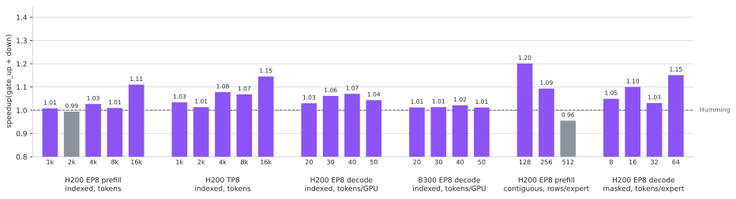

<!-- markdownlint-disable MD001 MD033 MD041 -->
<p align="center">
  <picture>
    <source media="(prefers-color-scheme: dark)" srcset="docs/assets/logo_lockup_dark.svg">
    
  </picture>
</p>

<h3 align="center">
Novita Labs' production MoE CUDA kernels
</h3>

<p align="center">
| <a href="#documentation"><b>Documentation</b></a> | <a href="https://novita.ai"><b>Novita AI</b></a> | <a href="https://blogs.novita.ai"><b>Blog</b></a> |
</p>

---

Chord (Python package `chord_kernels`) is a set of W4A16 MoE CUDA operators
(BF16 activation, INT4 weight, group-32 scale) tuned for serving the Kimi K2.5
family (K2.5/K2.6/K2.7).

## Supported configurations

| Interface | GPU | Tuned scenarios |
| --- | --- | --- |
| `indexed` | H200 | EP8 prefill and decode, TP8 (mixed) |
| `contiguous` | H200 | Prefill, EP8/EP16/EP32 |
| `masked` | H200 | Decode, EP8/EP16/EP32 |
| `indexed` | B200/B300 | EP8 decode |

## Performance

speedup(gate_up + down) over
[`vllm-project/humming@b4f3fc6`](https://github.com/vllm-project/humming/commit/b4f3fc6ee1dfc637cb8081e57c02c4bf1791c5f1)
(2026-10-19) on the same GPU, detailed in [docs/performance.md](docs/performance.md).

<picture>
  <source media="(prefers-color-scheme: dark)" srcset="docs/assets/benchmark_chart_dark.svg">
  
</picture>

## Installation

```bash
pip install git+https://github.com/novitalabs/chord.git
```

## Quick start

### indexed

```python
import torch
from chord_kernels import indexed, indexed_block_m, pack_w4a16

weight = pack_w4a16(weight_uint4, scale)
locks = torch.zeros(1024, dtype=torch.int32, device="cuda")

# sorted_ids / expert_ids / num_tokens_padded: routing aligned to block_m
block_m = indexed_block_m(weight, num_tokens, top_k)
out = indexed(x, weight, sorted_ids, expert_ids, num_tokens_padded, top_k, locks=locks)
```

Details in [docs/getting_started.md](docs/getting_started.md).

### grouped (SM90)

```python
from chord_kernels import contiguous, masked, pack_w4a16

weight = pack_w4a16(weight_uint4, scale)                    # the same weight as indexed
out = masked(x3, weight, masked_m, expected_m)              # x3 [G, max_m, K] -> [G*max_m, N]
out = contiguous(x2, weight, m_indices)                     # x2 [m, K], 128-row padded per expert
```

## Documentation

- [docs/getting_started.md](docs/getting_started.md): API, routing contract, environment variables, tests.
- [docs/performance.md](docs/performance.md): measured tables, shapes and method.
- [docs/design.md](docs/design.md): kernels, schedule selection, stream-K.

## Acknowledgement

This project builds on

* [Humming](https://github.com/vllm-project/humming), whose indexed W4A16 MoE kernel the `indexed` operator derives from
* [DeepGEMM](https://github.com/deepseek-ai/DeepGEMM/), whose SM90 W4A16 GEMM and launch heuristics the `masked`/`contiguous` operators vendor
* [CUTLASS](https://github.com/nvidia/cutlass), for the CuTe/CUTLASS arch headers the kernels include
